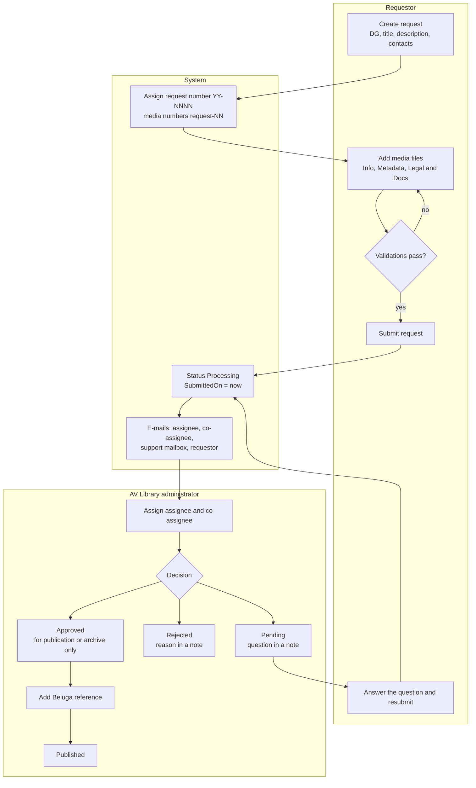
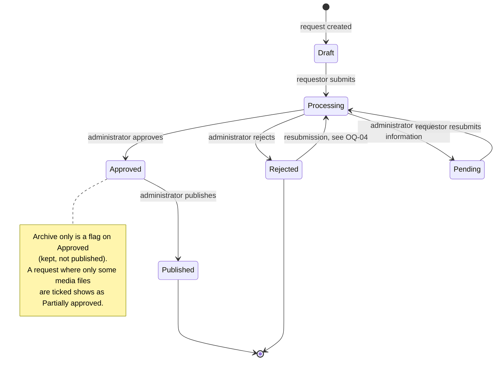
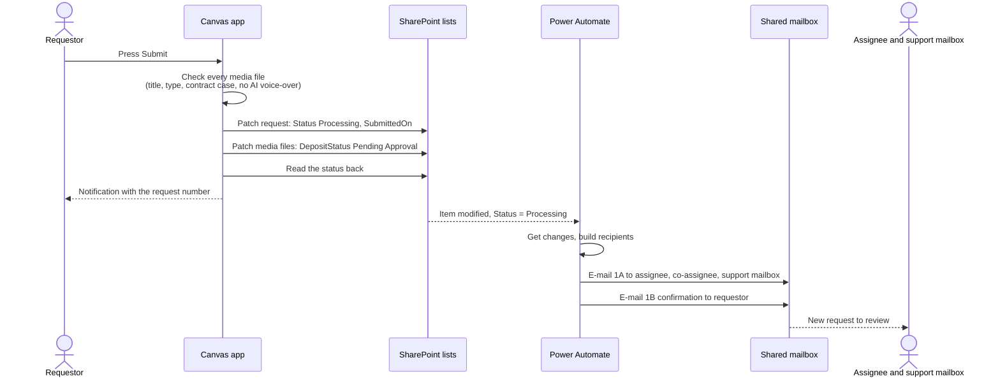
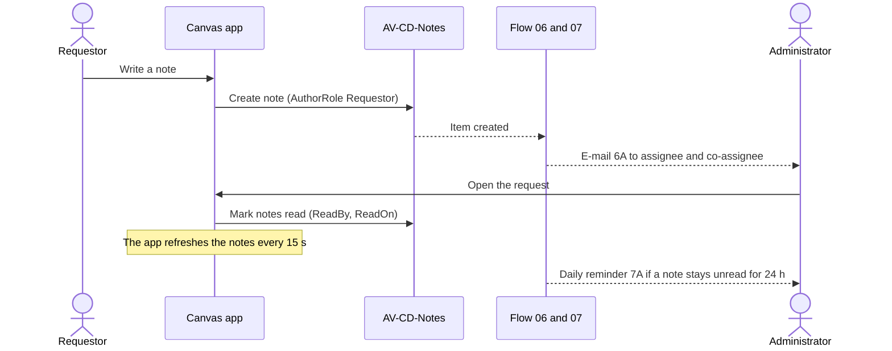
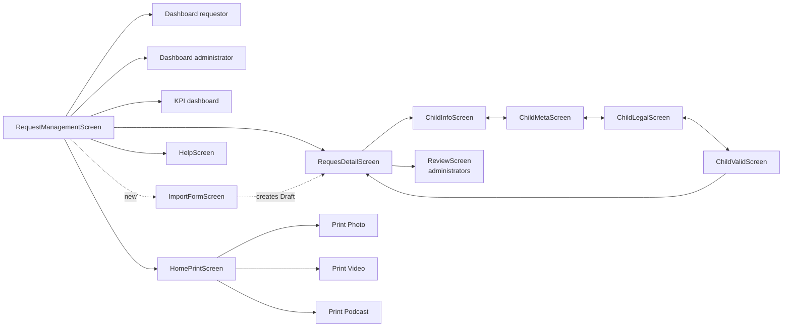
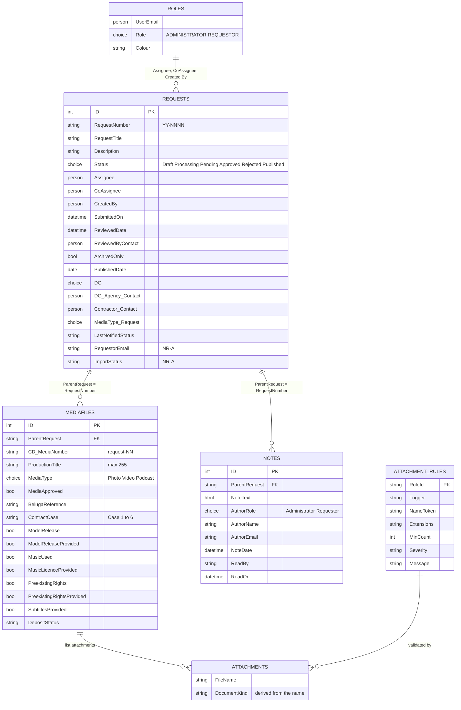
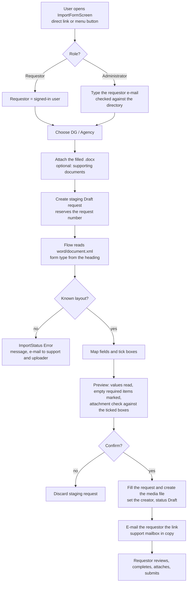
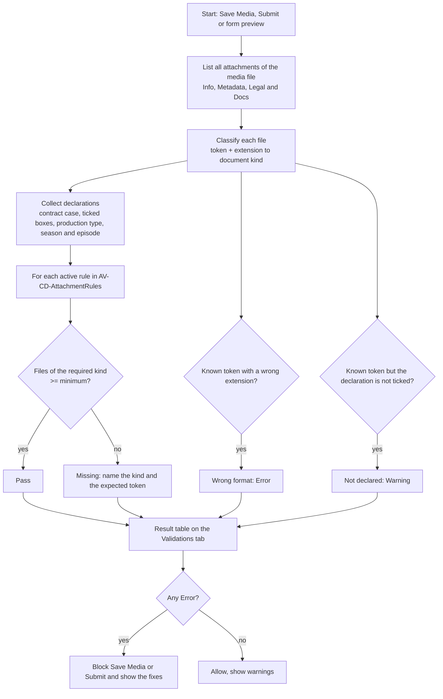
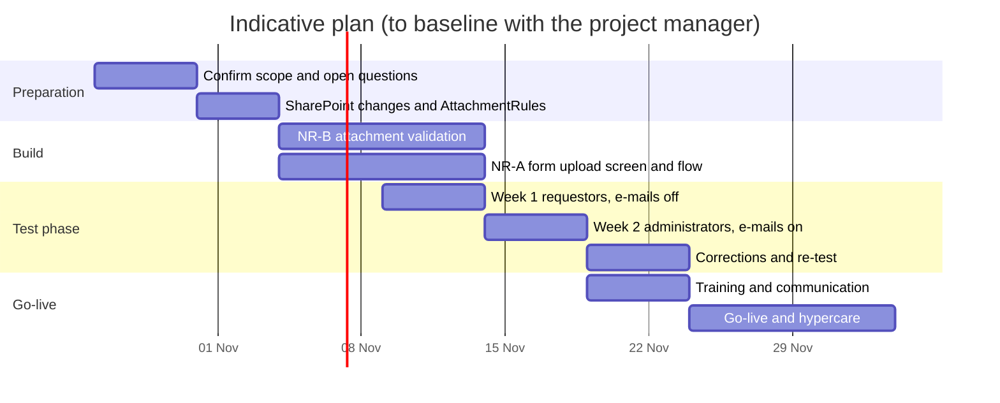

# AV Central Deposit: Business Analysis Document

| Item | Detail |
|---|---|
| **Document** | Business Analysis Document (BAD) for the implementation of the AV Central Deposit canvas application |
| **Version / status** | 1.0, draft for stakeholder review |
| **Date** | 2026-10-22 |
| **Document owner** | to be completed |
| **Approvers** | Audiovisual Service (DG COMM) product owner; AV Library lead; SharePoint / Power Platform owner |
| **Source material** | the application package (FINAL184 baseline, 15 screens), `power-automate-flows.md`, `import-form-spec.md`, `TEST-file-findings.md`, `test-phase-checklist.md`, SharePoint list schemas, and the change requests handled during the build |
| **Repository** | `docs/central-deposit-business-analysis.md` |

> **How to publish this page in Confluence.** The diagrams are Mermaid code blocks. Paste them into a *Mermaid* macro (for example a Mermaid diagram app from the Atlassian Marketplace). If your Confluence has no Mermaid macro, use the PNG exports in `docs/ba-diagrams/` (same names as the diagram titles) or import the Word copy `central-deposit-business-analysis.docx`, which has the diagrams embedded as images.

> **Assumption about "Mermaid platform".** The request asked for a document "to implement the Central Deposit canvas app in Mermaid platform". Mermaid is a diagramming language, not an application platform, so this document is **platform-neutral**: it states *what* the business needs and the rules the solution must follow, and models the processes, states, data and flows in Mermaid. The reference implementation described in the "As-built" columns is Microsoft Power Apps (canvas app) with SharePoint lists and Power Automate. Section 16 lists what any target platform must provide, so the document can drive an implementation elsewhere. **Please confirm what "Mermaid platform" means for you** (open question OQ-01).

> **Test status.** Everything marked *In app* has been built and checked at file level (structure, formulas, App Checker). It has **not yet been run end to end in the production tenant**; the two-week test phase (section 19) is what proves it.

---

## 1. Executive summary

The Audiovisual Service receives audiovisual material (photo and reportage, video, podcast) produced under contract for the European institutions. Before the material is kept in the archive or published, the AV Library must check the metadata, the contract situation and the legal documents. Today this is done with e-mails, Word metadata forms and manual re-typing.

**AV Central Deposit** replaces that with one controlled channel: a **requestor** describes the production and its media files, declares the rights and attaches the legal documents; an **administrator** of the AV Library reviews, asks for information, approves (for publication or for the archive only), or rejects; both talk in a **Message Center** attached to the request; e-mails keep everybody informed; dashboards show the workload.

This document defines the business need, the processes, the rules, the data, the integrations, the non-functional requirements, the implementation approach and the acceptance criteria. It also adds **two new requirements** requested during the analysis:

1. **NR-A, Upload of the production form as a Draft request** (a screen that reads the filled Word form and creates the draft automatically), section 10.
2. **NR-B, Attachment validation by file name and by the ticked check boxes**, section 11.

## 2. Purpose, scope and objectives

### 2.1 Purpose
Give the project team, the build team and the testers one agreed description of what the Central Deposit must do and why.

### 2.2 In scope
- Requests and their media files (Photo/Reportage, Video, Podcast) from Draft to Published or Archive only.
- Metadata capture per production type, contract cases 1 to 6, rights and declarations, legal annexes.
- Review and decision by administrators, assignment and co-assignment, Beluga reference.
- Message Center (notes with read receipts) between requestor and administrators.
- E-mail notifications and reminders (Power Automate).
- Dashboards (requestor, administrator, KPI), print and export screens.
- Roles and permissions (ADMINISTRATOR, REQUESTOR) and the view-only rules.
- **NR-A** form upload as Draft and **NR-B** attachment validation.
- Test phase and acceptance.

### 2.3 Out of scope
- Publication itself on the web portal and the Beluga system (the app records the Beluga reference; it does not integrate).
- The FTP delivery of the large files (the app records the delivery path).
- Second approval of a decision (flow 5 was specified and is **not** part of the package).
- Migration of historical requests (open question OQ-09).

### 2.4 Objectives and success measures

| # | Objective | Measure (to baseline before go-live; no target figures are assumed here) |
|---|---|---|
| O1 | One channel for every request, with a unique number | % of requests received through the app; requests without number = 0 |
| O2 | Complete and valid metadata at the first submission | % of requests accepted without a "need info" round; fields corrected per request |
| O3 | Faster review | days from Submitted to first administrator action; days from Submitted to decision |
| O4 | Legal compliance evidence kept with the media | % of approved media files with the mandatory legal documents attached and correctly named |
| O5 | Traceable communication | % of decisions with a note; unread notes older than 24 h |
| O6 | Less manual typing | time to create a request from a Word form (before / after NR-A) |

## 3. Stakeholders and roles

| Stakeholder | Role in the process | Interest / need |
|---|---|---|
| **Requestor** (DG, agency, contractor representative; role `REQUESTOR`) | Creates and submits requests, answers questions, resubmits | Simple guided form, clear validation messages, status visibility, no re-typing |
| **AV Library administrator** (role `ADMINISTRATOR`) | Reviews, asks for information, approves, rejects, publishes, adds the Beluga reference | Complete files, one place for the conversation, workload overview |
| **Assignee / co-assignee** | The administrators in charge of one request | Receive only the e-mails of their requests |
| **Support mailbox owner** (Audiovisual Service, DG COMM) | Receives a copy of every relevant e-mail | Evidence and a safety net |
| **Product owner / Audiovisual Service management** | Owns rules and priorities | KPIs, compliance |
| **SharePoint / Power Platform owner** | Provisions lists, roles, flows, connections | Maintainable, documented solution |
| **Legal / contract officers** (consulted) | Define the contract cases and the mandatory documents | Rules applied consistently |
| **Accessibility and security officers** (consulted) | Review non-functional requirements | Compliance |

## 4. Current situation and pain points (to confirm with the AV Library)

| Pain point | Consequence |
|---|---|
| Metadata arrives as Word forms by e-mail and is re-typed | Errors, delay, duplicated work |
| No single request number across e-mails | Hard to follow a request |
| Legal documents arrive in different formats and names | Cannot check at a glance whether the file is complete |
| Questions and answers live in personal mailboxes | No history, no read evidence |
| No workload view | Late reviews are noticed late |

## 5. Business process models

### 5.1 End-to-end process

### 5.2 Request status model

### 5.3 Submission and notification (sequence)

### 5.4 Message Center

## 6. Functional requirements

Priority uses MoSCoW (M = must, S = should, C = could). Status: **In app** = built in the baseline, **Partly** = built with a gap stated, **New** = specified here, to be built.

### 6.1 Requests

| ID | Requirement | Pri | Status |
|---|---|---|---|
| REQ-01 | A requestor can create a request with title, description, DG / Agency and the official and contractor contacts (people from the directory or e-mail addresses typed by hand). | M | In app |
| REQ-02 | Every request gets a unique number `YY-NNNN` when it is created. | M | In app |
| REQ-03 | A request can be saved as **Draft** at any time and reopened later. | M | In app |
| REQ-04 | A request holds one or more media files; each media file gets the number `<request number>-NN`. | M | In app |
| REQ-05 | On Submit the app checks every media file (title, production type, contract case, no AI-generated voice-over), sets the status **Processing**, writes the submission date and time, and reads the status back to confirm. | M | In app |
| REQ-06 | After a successful submit the notification shows the request number. | M | In app |
| REQ-07 | "Archive only" can be ticked: the request is processed like any other and, when approved, is kept but not published. | M | In app |
| REQ-08 | A requestor sees only their own requests, with status filters; an administrator sees every request that is not someone else's draft. | M | In app |
| REQ-09 | A request opens from a link (`&RequestID=<ID>`) with the viewer's own permissions. | M | In app |
| REQ-10 | After a "need info" the requestor edits and resubmits; the request returns to Processing. | M | In app |

### 6.2 Media files

| ID | Requirement | Pri | Status |
|---|---|---|---|
| MED-01 | Production types: **Photo / Reportage, Video, Podcast**. The fields shown and required depend on the type (appendix A). | M | In app |
| MED-02 | A media file is edited on tabs **Info**, **Metadata**, **Legal & Docs** and **Validations**; *Save Media* is blocked until the validations pass. | M | In app |
| MED-03 | Single-line text fields accept at most **255 characters**; the limit is shown and enforced (production title, shotlist / script and the other text columns). | M | In app |
| MED-04 | Rich-text SharePoint columns (description, notes, photo caption, photographer name) are shown and saved as plain text in the form. | S | In app |
| MED-05 | **Copy from previous media file**: pre-fills every field from an earlier media file **of the same production type**; attachments and the Beluga reference are never copied; the original is never changed. | S | In app |
| MED-06 | **Podcast**: season and episode number; podcast visual (JPEG or PNG, square, 1400 to 3000 px) mandatory when season 1 episode 1; episode visual (1280 x 720); audio files MP3, WAV, M4A or AAC; VTT subtitles, never SRT. | M | Partly (the app checks the file type; pixel sizes are shown as guidance) |
| MED-07 | **Video**: language versions, type of product, producer, optional VTT subtitles (SRT refused). | M | In app |
| MED-08 | **Photo / Reportage**: description, place, photo caption, contracting authority, free-text photographer, contractor / agency, FTP delivery path. | M | In app |
| MED-09 | The **Beluga reference** is entered by administrators and is read-only for requestors; it is editable in every status except Draft and Pending. | M | In app |
| MED-10 | The submission date is shown with the **time** in every list (needs the SharePoint column type *Date and time*, see section 12). | S | Partly (column type to change) |

### 6.3 Legal and rights

| ID | Requirement | Pri | Status |
|---|---|---|---|
| LEG-01 | The **contract case** (1 to 6, table in 7.3) is mandatory for every media file. | M | In app |
| LEG-02 | **Case 1** requires both the signed framework contract and the signed specific contract to be confirmed; the offer is optional. | M | In app |
| LEG-03 | Rights and declarations: no third-party rights; recognisable private persons (model release); music (licence); pre-existing rights (annex); subtitles provided (VTT). Each follow-up ("provided") appears only when its declaration is ticked. | M | In app |
| LEG-04 | An AI-generated voice-over is not accepted and blocks the media file. | M | In app |
| LEG-05 | At least one **legal annex** is attached to every media file. | M | In app |
| LEG-06 | The documents declared are really attached and correctly named (see NR-B). | M | **New** |

### 6.4 Review and decision

| ID | Requirement | Pri | Status |
|---|---|---|---|
| REV-01 | An administrator reviews a submitted request and can **approve, reject, or ask for information (Pending)**. A message is written for the decision and stored as a note. | M | In app |
| REV-02 | When only some media files are ticked as approved, the request shows **Partially approved**. | S | In app |
| REV-03 | **Approved, archive only**: the decision records that the material is kept but not published, with a reason. | M | In app |
| REV-04 | An approved request can be moved to **Published**. | M | In app |
| REV-05 | An administrator can be **assignee** and another **co-assignee**; each administrator has a colour used in lists and dashboards. | M | In app |
| REV-06 | Lock rules (7.2): who can edit a request in which status. An administrator who is not the creator is always **view-only**. | M | In app |

### 6.5 Message Center

| ID | Requirement | Pri | Status |
|---|---|---|---|
| MSG-01 | Each request has a Message Center with notes from requestors and administrators (rich text), author, role and time. | M | In app |
| MSG-02 | Unread notes are counted per request; reading marks them read (who and when). | M | In app |
| MSG-03 | The notes refresh by themselves every 15 seconds; the last message appears as a tooltip on the notes button. | S | In app |
| MSG-04 | An administrator's decision message (rejection reason, question, approval comment, archive-only reason) is a note in the same Message Center. | M | In app |

### 6.6 Notifications

| ID | Requirement | Pri | Status |
|---|---|---|---|
| NOT-01 | E-mails are sent for: submission, decision, resubmission, assignment changes, new note, unread reminder, review overdue, waiting for the requestor (table in section 13). | M | In app (flows imported turned off) |
| NOT-02 | The **support mailbox** is always among the recipients; e-mails to "the administrators" go only to the assignee and co-assignee, or to all administrators when nobody is assigned yet. | M | In app |
| NOT-03 | Every e-mail carries a link that opens the request; the link is safe to forward because the app checks the viewer's role. | M | In app |

### 6.7 Dashboards, print and export

| ID | Requirement | Pri | Status |
|---|---|---|---|
| DSH-01 | An operational dashboard for the **requestor** and one for the **administrator** (counters by status, lists, refresh icon, last-update time). | M | In app |
| DSH-02 | A **KPI dashboard** with the cards by status; average processing time and trend only for administrators. | S | In app |
| PRT-01 | Print and export screens for a request and for each production type, with a **submission date range** filter. | S | In app |
| HLP-01 | A help screen explains the process and the rules. | C | In app |

### 6.8 Security

| ID | Requirement | Pri | Status |
|---|---|---|---|
| SEC-01 | Roles come from the list `AV-CD-RolesPermissionsList` (`ADMINISTRATOR`, `REQUESTOR`). | M | In app |
| SEC-02 | Role-restricted buttons and screens are hidden or disabled for other roles. | M | In app |
| SEC-03 | Data is read and written with the signed-in user's own permissions on the SharePoint site. | M | In app |

### 6.9 New requirements (summary)

| ID | Requirement | Pri | Status |
|---|---|---|---|
| NR-A (IMP-01 to IMP-12) | A screen to upload the filled production form and create a **Draft** request automatically. Section 10. | S | New (an earlier prototype exists, see 10.1) |
| NR-B (ATT-01 to ATT-14) | Validation of the attachments by **file name** and by the **check boxes** selected. Section 11. | M | New |

## 7. Business rules

### 7.1 Numbering and fields

| ID | Rule |
|---|---|
| BR-01 | Request number `YY-NNNN`, unique; media number `<request number>-NN`. |
| BR-02 | Status values: `Draft`, `Processing`, `Pending` (shown as "Need info"), `Approved`, `Rejected`, `Published`. Older rows can hold `Partially approved`. |
| BR-03 | Single-line text: maximum 255 characters. |
| BR-04 | Podcast visual: JPEG or PNG; mandatory when season and episode are both 1; episode visual 1280 x 720 px. |
| BR-05 | Video subtitles are VTT; SRT is refused. |
| BR-06 | Publication end date is not earlier than the publication start date; production end date is not earlier than the filming date. |

### 7.2 Who can edit what (lock logic)

| Viewer | Draft | Processing | Pending | Approved | Rejected | Published |
|---|---|---|---|---|---|---|
| Requestor (creator) | edit | view | **edit** | view | view | view |
| Administrator who created the request | edit | edit | view | view (Beluga editable) | edit | view (Beluga editable) |
| Administrator who is **not** the creator | view | view | view | view | view | view |
| Request opened from a dashboard ID box | view | view | view | view | view | view |

Administrators act on a request through the **Review** screen (decision, assignment, Beluga reference); the table above is about editing the request content.

### 7.3 Contract cases

| Case | Meaning | Mandatory confirmation today | Evidence expected (NR-B) |
|---|---|---|---|
| 1 | Framework / direct service contract | signed framework contract **and** signed specific contract; offer optional | framework contract, specific contract, offer if ticked |
| 2 | Specific service contract | none beyond the annex | specific contract |
| 3 | Co-production agreement | none beyond the annex | co-production agreement |
| 4 | Acquisition of existing material | none beyond the annex | acquisition contract or licence |
| 5 | Internal EU production | none beyond the annex | internal production declaration |
| 6 | Donation / free licence | none beyond the annex | donation or licence document |

The last column for cases 2 to 6 is a **proposal** to confirm with the contract officers (OQ-06).

### 7.4 Decision rules

| ID | Rule |
|---|---|
| BR-10 | Reject, Pending and archive-only decisions need a written message (a note). |
| BR-11 | A request moves to Processing only through Submit or Resubmit. |
| BR-12 | The decision date and the reviewer are recorded (`ReviewedDate`, `ReviewedByContact`). |
| BR-13 | Reminders: Processing for more than 7 calendar days (about 5 working days) goes to the assignee, the co-assignee and the support mailbox; Pending for more than 7 days goes to the requestor with the assignee in copy; at most one reminder every 3 days. |
| BR-14 | A note unread for 24 hours triggers a daily reminder to the other party. |

## 8. Screens and navigation (baseline of 15 screens)

| Screen | Purpose |
|---|---|
| `RequestManagementScreen` | The list of requests with status filters; entry to create or open a request |
| `RequesDetailScreen` | One request: data, media files list, Message Center, Submit / Resubmit |
| `ChildInfoScreen` | Media file, tab Info (title, description, type-specific fields, template picker) |
| `ChildMetaScreen` | Media file, tab Metadata (dates, place, producer, season and episode, files) |
| `ChildLegalScreen` | Media file, tab Legal & Docs (contract case, rights and declarations, annexes) |
| `ChildValidScreen` | Media file, tab Validations (checklist that gates *Save Media*) |
| `ReviewScreen` | Administrator decision, assignment, Beluga reference |
| `Dashboard-Ope-Requestor` | Requestor operational dashboard |
| `Dashboard-Ope-Administrator` | Administrator operational dashboard |
| `DashboardScreen` | KPI dashboard |
| `HomePrintScreen` | Print / export entry with the date range |
| `PrintPhotoDetailScreen`, `PrintVideoDetailScreen`, `PrintPodcastDetailScreen` | Print layouts per production type |
| `HelpScreen` | Help |
| **`ImportFormScreen`** (new, NR-A) | Upload of the production form as Draft |

### 8.1 Wireframes and design system in Figma

All 15 screens of the baseline, in their role and production-type variants (28 frames), and the four screens of the new requirements are in the Figma file **AV Central Deposit - App Screens** (https://www.figma.com/design/VMPaCaMP1CetCL9RdQRuZD): page `Screens` (32 frames), page `Components` (Button, Input, Checkbox, Status badge), page `Foundations` (tokens, type scale). The design system rules, the token table, the mapping of components to Power Apps controls and the frame index are in `docs/figma-design-system-rules.md`.

| New screen (frame) | Requirement |
|---|---|
| `ImportFormScreen / NR-A upload (administrator)` | NR-A IMP-01 to IMP-05, IMP-09 |
| `ImportFormScreen / NR-A preview and attachment check` | NR-A IMP-07, IMP-08 and NR-B ATT-03 to ATT-06 |
| `ChildValidScreen / NR-B attachment rules (proposed)` | NR-B ATT-03 to ATT-09 |
| `ChildLegalScreen / NR-B file-name hint and classification (proposed)` | NR-B ATT-01, ATT-07, ATT-10 |

The wireframes are generated from the app source and are not a pixel-perfect capture; the limits are listed in section 9 of the design rules.

## 9. Data model

Notes on the model:
- The lists are `AV-CD-Requests`, `AV-CD-Mediafiles` (93 columns, only the title is required in SharePoint, so the **app** enforces the business rules), `AV-CD-Notes`, `AV-CD-RolesPermissionsList`. `AV-CD-AttachmentRules` is new (NR-B).
- Request and media files are linked by the **request number**, not by a lookup column.
- Person columns are written with the claim `i:0#.f|membership|<mail>`.
- Row limit: lists must stay under the app's data row limit (2000 in the app) and filters must be delegable; index `Status`, `RequestNumber`, `ParentRequest` and `ReadOn` if the lists grow beyond 5,000 items.

## 10. New requirement NR-A: upload the production form as a Draft request

### 10.1 Business need and current state
Requestors and contractors already fill a **Word metadata form** (one form per production type: Photos, Video, Podcast) and send it by e-mail. Someone then re-types it. The need is a **screen where the filled form is uploaded and a Draft request is created automatically**, already filled, so the requestor only reviews, adds the attachments and submits.

State: an earlier prototype existed in package versions FINAL113 to FINAL115 with the flow `CD - 09 Import form` (specification in `import-form-spec.md`). The **current 15-screen baseline does not contain it**, so it is specified here as a requirement to (re)introduce. The Word templates need one fix: the video form's "Subtitles provided" boxes are old symbol boxes and must be replaced by Word check-box content controls.

### 10.2 Process

### 10.3 Requirements

| ID | Requirement | Pri |
|---|---|---|
| IMP-01 | A dedicated screen `ImportFormScreen`, reachable by a direct link and by a button visible to administrators (and to requestors for their own forms). | S |
| IMP-02 | An administrator enters the requestor e-mail; the screen says whether it is a known person (shows the name) or not (warning). A requestor can import only for themselves. | S |
| IMP-03 | Only `.docx` is accepted (not PDF); the form version is checked from the heading and labels; an unknown layout stops with a clear error and imports nothing. | M |
| IMP-04 | The flow fills the request (title, description, DG, production type) and creates **one media file** with the form data (field mapping in `import-form-spec.md`, section 4). | M |
| IMP-05 | The Word check boxes (contract case 1 ticks, model release, music, pre-existing rights, subtitles) are read **only when the control state is checked**. | M |
| IMP-06 | Dates typed as free text are accepted as `dd/mm/yyyy`, `dd-mm-yyyy` or `yyyy-mm-dd`; anything else stays empty and is listed in the import message. | S |
| IMP-07 | The result is always status **Draft**; nothing is submitted automatically. | M |
| IMP-08 | A **preview** shows what was read, marks empty required items and runs the attachment check of NR-B before the user confirms. | S |
| IMP-09 | The requestor owns the draft (`Created By`); if the e-mail is not a person, the draft is created by the flow account and the e-mail is kept in `RequestorEmail`. | M |
| IMP-10 | The requestor receives an e-mail with the link `<app>&RequestID=<ID>`; the support mailbox is in copy. | M |
| IMP-11 | Errors are visible: `ImportStatus = Error` and `ImportMessage`, an e-mail to the support mailbox and the uploader, no half-created request left behind. | M |
| IMP-12 | Probable duplicate (same requestor and title within 7 days) is warned, not blocked. | C |

Import statuses: `New`, `Uploaded`, `Reading`, `Parsed`, `Confirmed`, `Creating`, `Done`, `Error`. The staging request stays hidden from every list until `Done`.

### 10.4 Acceptance criteria (examples)

| # | Given / When / Then |
|---|---|
| IMP-AC1 | Given an administrator, when they open the screen, then the requestor e-mail field is required and the button *Create draft request* stays disabled until a `.docx` is attached. |
| IMP-AC2 | Given a filled video form, when the import finishes, then a request in status Draft exists with title, description and the video metadata filled, one media file `…-01`, and the requestor as creator. |
| IMP-AC3 | Given a form whose heading is not one of the three known forms, when the flow runs, then `ImportStatus = Error`, the message names the problem and no request is left visible. |
| IMP-AC4 | Given a form with "Recognisable persons" ticked and no model-release file attached, when the preview opens, then the line "Model release" is shown as **missing** (NR-B rule ATT-R03). |
| IMP-AC5 | Given the draft is created, when the requestor opens the link, then they can edit it (Draft) and an administrator who is not the creator sees it view-only. |

### 10.5 Risks and open points
The template may change (labels live in one table of the flow; the layout check fails loudly); the form carries personal data (retention, OQ-07); the flow needs a service account with OneDrive for Business for the *Extract archive* step; the original `.docx` is not kept on the media file because it would count as a legal annex (OQ-08).

## 11. New requirement NR-B: validate attachments by file name and by the ticked check boxes

### 11.1 Business need
Today the app only counts files and checks some extensions (at least one legal annex; podcast and episode visuals are JPEG or PNG; no `.srt`; a prefix `EpisodeVisual_` tells the episode visual from the podcast visual). The "document provided" boxes (framework contract, specific contract, model release, music licence, pre-existing rights annex) are **self-declared**: ticking them proves nothing. The need: **the files attached must match what is declared**, so that an administrator can see at a glance that the dossier is complete, and the requestor is told exactly what is missing or misnamed before submitting.

### 11.2 Concept
1. Every attached file is **classified** into a *document kind* from its **file name** (a token at the start of the name) and its **extension**.
2. Every ticked check box, selected contract case and production type **requires** one or more document kinds.
3. The validation compares *required* with *found* and reports, per rule, **Pass**, **Missing**, **Misnamed** or **Not declared**.
4. The rules live in a **configuration list** (`AV-CD-AttachmentRules`), not in formulas, so the AV Library can change a token or a requirement without a new version of the app.

### 11.3 Proposed naming convention (to confirm, OQ-05)
`<KIND>_<free text>.<extension>`, for example `FRAMEWORK_Contract2026-014.pdf`, `MODELRELEASE_J-Dupont.pdf`, `SUBTITLES_EN.vtt`. The token is not case sensitive; `_` or `-` after the token; the free text is up to the requestor.

| Document kind | Token | Extensions | Required when | Today |
|---|---|---|---|---|
| Signed framework contract | `FRAMEWORK` | pdf | Contract case 1 and "Signed framework contract" ticked | tick only |
| Signed specific contract | `SPECIFIC` | pdf | Case 1 and "Signed specific contract" ticked; case 2 | tick only |
| Offer | `OFFER` | pdf | "Offer" ticked (case 1, optional) | not checked |
| Co-production agreement | `COPRODUCTION` | pdf | Case 3 | proposal |
| Acquisition contract / licence | `ACQUISITION` | pdf | Case 4 | proposal |
| Internal production declaration | `INTERNAL` | pdf | Case 5 | proposal |
| Donation / free-licence document | `DONATION` | pdf | Case 6 | proposal |
| Model release | `MODELRELEASE` | pdf, jpg, png | "Recognisable private persons" ticked **and** "Model release provided" ticked | optional |
| Music licence | `MUSICLICENCE` | pdf | "Contains music" ticked and "licence provided" ticked | tick only |
| Pre-existing rights annex | `PREEXISTING` | pdf | "Pre-existing rights" ticked and "provided" ticked | optional |
| Subtitles | `SUBTITLES` (optionally `SUBTITLES_<language>`) | **vtt** only | "Subtitles are provided" ticked (video) | `.srt` refused, `.vtt` optional |
| Podcast visual | `PODCASTVISUAL` | jpg, jpeg, png | Podcast, season 1 and episode 1 | JPEG/PNG check, by position |
| Episode visual | `EPISODEVISUAL` | jpg, jpeg, png | Podcast (optional) | prefix `EpisodeVisual_` already used |
| Audio | `AUDIO` | mp3, wav, m4a, aac | Podcast | by extension |
| Other supporting document | *(any other name)* | pdf, docx, jpg, png | never required | counts as annex |

### 11.4 Requirements

| ID | Requirement | Pri |
|---|---|---|
| ATT-01 | Each attachment is classified by token and extension; a file without a known token is *Other supporting document*. | M |
| ATT-02 | The rule set is read from `AV-CD-AttachmentRules` (trigger, token, extensions, minimum count, severity, message). | S |
| ATT-03 | **Declared but missing**: a ticked box or selected case whose required document kind has fewer files than the minimum is reported with the missing kind named (for example "Model release declared, no file named MODELRELEASE_… attached"). Severity *Error* blocks *Save Media* and Submit. | M |
| ATT-04 | **Attached but not declared**: a file whose token is known but whose declaration is not ticked is reported (for example `MUSICLICENCE_x.pdf` while "contains music" is unticked). Severity *Warning*: the user can continue. | S |
| ATT-05 | **Wrong format**: a known token with an extension outside the list (for example `SUBTITLES_EN.srt`, `PODCASTVISUAL_x.gif`) is an Error. | M |
| ATT-06 | **Case 1**: both `FRAMEWORK` and `SPECIFIC` files are required in addition to the two ticks; `OFFER` only when its box is ticked. | M |
| ATT-07 | The "provided" boxes are **derived**: the follow-up box ("Model release provided", "Music licence provided", "Pre-existing rights provided") shows as satisfied only when the matching file exists; the user cannot tick it without the file. | S |
| ATT-08 | Duplicate file names in the same media file are refused; characters SharePoint does not accept in file names are reported before saving. | M |
| ATT-09 | The Validations tab lists every rule with its result and a plain-language fix; the same text appears on the Submit check. | M |
| ATT-10 | A **file-name hint** next to the attachment control shows the convention and the kinds expected for the current declarations. | S |
| ATT-11 | The check runs on the three entry points: *Save Media*, *Submit request*, and the preview of the form upload (NR-A). | M |
| ATT-12 | An administrator sees the classification result on the Review screen (kind, file, pass or missing) without opening each media file. | S |
| ATT-13 | Because a canvas app check can be bypassed, a server-side check (flow on Submit) writes the result into the request and e-mails the support mailbox if a rule is broken. | C |
| ATT-14 | Rules are testable: every rule has at least one passing and one failing example in the test checklist. | M |

### 11.5 Validation algorithm

### 11.6 Examples

| Declaration | Files attached | Result |
|---|---|---|
| Case 1, both contracts ticked | `FRAMEWORK_C-2026-14.pdf`, `SPECIFIC_SC-07.pdf` | Pass |
| Case 1, both ticked | `FRAMEWORK_C-2026-14.pdf` | Error: specific contract file missing |
| Recognisable persons ticked, model release provided ticked | `contract.pdf` | Error: model release declared, no `MODELRELEASE_…` file; `contract.pdf` counted as other supporting document |
| Music not ticked | `MUSICLICENCE_track.pdf` | Warning: licence attached but music not declared |
| Video, subtitles provided ticked | `SUBTITLES_EN.srt` | Error: SRT not accepted, attach VTT |
| Podcast season 1 episode 1 | no `PODCASTVISUAL_…` file | Error: podcast visual missing |
| Any | two files named `SPECIFIC_a.pdf` | Error: duplicate file name |

### 11.7 Acceptance criteria (examples)

| # | Given / When / Then |
|---|---|
| ATT-AC1 | Given case 1 with both contract boxes ticked and only `FRAMEWORK_x.pdf` attached, when the user presses *Save Media*, then the save is blocked and the Validations tab names the missing `SPECIFIC` file. |
| ATT-AC2 | Given a rule changed in `AV-CD-AttachmentRules` (for example the token `MODELRELEASE` renamed), when the app is reopened, then the new token is applied without a new app version. |
| ATT-AC3 | Given a file with an unknown name, when the media file is validated, then it counts as *Other supporting document* and satisfies the "at least one legal annex" rule only. |
| ATT-AC4 | Given the requestor unticks "contains music", when `MUSICLICENCE_x.pdf` is still attached, then a warning (not an error) is shown and Submit remains possible. |
| ATT-AC5 | Given an administrator opens the Review screen, when the request has a missing mandatory document, then the line is marked missing next to the media file. |

### 11.8 Risks
Requestors may not follow a naming convention (mitigation: the hint, the clear message, an optional *rename on upload* helper later); renaming a file after upload is not possible in a SharePoint attachment control (the user deletes and re-attaches); the rules for cases 2 to 6 are proposals until the contract officers confirm them; the token list must be agreed once and published in the Help screen and in the e-mails.

## 12. SharePoint prerequisites

| Item | Action |
|---|---|
| `SubmittedOn` | Change the column to **Date and time** to show the hours (MED-10). |
| Roles list | Column `Colour` per administrator; at least one `ADMINISTRATOR` row. |
| Requests list | Versioning on (flows use "Get changes"); columns `LastNotifiedStatus`, `RequestorEmail`, marker columns used by the flows; import columns (NR-A). |
| Media list | Check the columns of the rights ticks and "provided" ticks; text columns are single line 255. |
| New list | `AV-CD-AttachmentRules` (NR-B), seeded with the table in 11.3. |
| Library | Folder `Shared Documents/UploadAVRequests` for NR-A. |
| Indexes | `Status`, `RequestNumber`, `ParentRequest`, `ReadOn`. |

## 13. Notifications and flows

| # | Flow | Trigger | E-mails and recipients |
|---|---|---|---|
| 01 | Request submitted | `Status = Processing`, first time | 1A to assignee, co-assignee and support mailbox (all administrators if nobody is assigned); 1B confirmation to the requestor |
| 02 | Status changed | Approved, Rejected or Pending, and `LastNotifiedStatus` differs | requestor, assignee, co-assignee, support mailbox; text depends on the status and includes the administrator's note |
| 03 | Resubmitted | `Status = Processing` after a review | 3A assignee, co-assignee, support mailbox; 3B acknowledgement to the requestor |
| 04 | Assignment | `Assignee` or `CoAssignee` changed | 4A new assignee, 4B previous assignee, 4C new co-assignee, 4D removed co-assignee, 4E requestor on first assignment |
| 05 | Second approval | not in the package | |
| 06 | New message | item created in `AV-CD-Notes` | requestor note to assignee and co-assignee; administrator note to the requestor; nobody is told about their own note |
| 07 | Unread reminder | weekdays 09:00 | the other party, one e-mail per request |
| 08 | Reminders | weekdays 08:30 | 8A review overdue (assignee, co-assignee, support); 8B waiting for the requestor |
| 09 | Import form | `ImportStatus` changes | requestor link, errors to support and uploader (NR-A) |
| 10 (optional) | Attachment audit | on Submit | support mailbox when a rule is broken (ATT-13) |

Conventions: the sender is the shared mailbox, reply-to is the support mailbox, HTML e-mails in English, each flow wrapped in a main scope with a catch scope that e-mails the support mailbox, concurrency 1 on flows 1 to 4, time zone Romance Standard Time. The flows are imported **turned off** and are switched on for week 2 of the test phase.

## 14. Reporting and KPIs

| KPI | Definition |
|---|---|
| Requests by status | count per `Status` for a period |
| Time to first action | `first administrator action` minus `SubmittedOn` |
| Time to decision | `ReviewedDate` minus `SubmittedOn` |
| Need-info rate | requests that passed through Pending / requests decided |
| Overdue reviews | Processing for more than 7 calendar days |
| Unread notes | notes with `ReadOn` empty for more than 24 h |
| Documents compliance (NR-B) | media files whose attachment rules all passed at Submit |

Dashboards show these counts with the refresh icon and a "last updated" time; the KPI dashboard hides the average-time card for requestors.

## 15. Non-functional requirements

| ID | Area | Requirement |
|---|---|---|
| NFR-01 | Performance | Lists use delegable filters; the app data row limit is 2000; the Message Center refresh is 15 s; the remaining App Checker performance notices are accepted by decision. |
| NFR-02 | Accessibility | Decorative controls hidden from screen readers, tab order and focus borders on interactive controls, accessible labels; the remaining checker items are handled in parts. Target: the institution's accessibility policy. |
| NFR-03 | Security | Role from the roles list; view-only rules (7.2); deep links re-check the role; no secret in the app; flows use a service account with least privilege. |
| NFR-04 | Audit | SharePoint versioning on requests; notes with author and time; read receipts; after saving a media file the app reads back about 40 fields to catch values SharePoint did not keep. |
| NFR-05 | Usability | English interface; clear validation messages naming the fix; mandatory fields marked with `*`; consistent EU-blue palette. |
| NFR-06 | Availability | Depends on Microsoft 365 availability; no extra infrastructure. |
| NFR-07 | Data protection | Personal data (names, e-mails, model releases) kept on the SharePoint site with its retention rules; retention decision pending (OQ-07). |
| NFR-08 | Maintainability | Business rules in lists where possible (NR-B); flows in a solution with environment variables; release notes per version. |
| NFR-09 | Compatibility | Modern browsers and the Power Apps mobile player for viewing; data entry is designed for desktop. |

## 16. Platform requirements (for any target platform)

Whatever platform implements this document must provide: role-based access for two roles and per-record edit locks; lists or tables with person fields, choice fields, rich text, multi-file attachments per record and version history; a form engine with conditional visibility and validation; a rules/configuration store editable without a release; workflow automation with e-mail sending from a shared mailbox, scheduled runs and "what changed" detection; deep links that carry a record id; a directory lookup for people; a document-reading step for `.docx` (NR-A); dashboards and printing/export; audit trail. The reference build uses Power Apps, SharePoint, Power Automate, Office 365 Users and Office 365 Outlook, plus OneDrive for Business for the form import.

## 17. Assumptions, constraints, dependencies and risks

### 17.1 Assumptions
All users are Microsoft 365 accounts of the institution; administrators belong to the AV Library; the SharePoint site `GRP-EBSProductionForm` is the home of the data; the support mailbox exists and can be used as the sender.

### 17.2 Constraints
Canvas app limits (controls per screen, delegation, 2000-row data limit); SharePoint list attachment handling (no rename in place); no Beluga integration; flows are imported off.

### 17.3 Risks

| ID | Risk | Likelihood | Impact | Mitigation |
|---|---|---|---|---|
| R1 | Business rules not agreed (cases 2 to 6, file tokens) | M | H | Workshop with contract officers before NR-B build (OQ-05, OQ-06) |
| R2 | Not run end to end in the tenant yet | H | H | Two-week test phase with real cases |
| R3 | Requestors ignore the naming convention | M | M | Hint, clear errors, Help screen, e-mail guidance |
| R4 | Flow e-mails reach wrong people | L | H | Recipient rule fixed (NOT-02), flows off until week 2, test mailbox |
| R5 | Large lists degrade performance | L | M | Indexes, delegable filters, archive old requests |
| R6 | Word template changes break NR-A | M | M | Labels in one table, layout check fails loudly |
| R7 | Blank values after save (SharePoint did not keep a field) | M | M | Read-back audit and diagnostics are in the app; watch during tests |
| R8 | Accessibility findings remain | M | M | Handle by parts; document accepted items |

## 18. Implementation approach

Steps: (1) confirm the open questions; (2) SharePoint changes (section 12); (3) import the app and the flow solution, reconnect the connections; (4) seed the roles list and the rules list; (5) test phase (section 19); (6) fix, re-test; (7) training: a one-page guide for requestors (including the file naming convention), a guide for administrators; (8) switch the flows on, announce, hypercare with a daily review of the support mailbox.

**Change management.** Communicate the new channel and the date after which e-mailed forms are no longer processed; name two champions per DG; collect feedback through the support mailbox; review the KPIs after four weeks.

## 19. Test strategy and acceptance

- **Week 1, requestors, notification e-mails off:** at least one request for every cell of the matrix *contract case 1 to 6 x Photo/Reportage, Video, Podcast*; extra scenarios (three media files, archive only, copy from previous, draft reopened, empty mandatory fields, 255 characters, special characters, attachments, AI declarations, print screens, a Pending request edited and resubmitted).
- **Week 2, administrators, all e-mails on:** approve (all media, some media, archive only), reject, pending, assign and co-assign, notes in both directions, view-only for a non-creator administrator, and tick every e-mail in the e-mail table.
- **New in this version:** one passing and one failing case per attachment rule (NR-B) and one import per form type (NR-A).
- The detailed checklist is `docs/test-phase-checklist.md` (and `.docx`).

**Acceptance criteria for go-live:** every cell of the coverage matrix passed at least once; every e-mail of the table received by the right recipients with a working link; no blocking defect open; the support mailbox receives its copies; the KPIs can be read from the dashboards; the approvers sign the document.

## 20. Traceability matrix

| Objective | Requirements | Business rules | Screens | Flows | Test |
|---|---|---|---|---|---|
| O1 one channel, unique number | REQ-01 to REQ-05 | BR-01, BR-02 | RequestManagementScreen, RequesDetailScreen | 01 | Week 1 matrix |
| O2 complete metadata | MED-01 to MED-08, LEG-01 to LEG-05 | BR-03 to BR-06, 7.3 | ChildInfo, ChildMeta, ChildLegal, ChildValid | | Week 1 extra scenarios |
| O3 faster review | REV-01 to REV-06, REQ-10 | BR-10 to BR-13 | ReviewScreen, dashboards | 01 to 04, 08 | Week 2 administrator checklist |
| O4 legal evidence | LEG-06, **NR-B (ATT-01 to ATT-14)** | 7.3, 11.3 | ChildLegalScreen, ChildValidScreen, ReviewScreen | 10 | ATT-AC1 to AC5 |
| O5 traceable communication | MSG-01 to MSG-04, NOT-01 to NOT-03 | BR-14 | RequesDetailScreen | 06, 07 | Week 2 e-mail checks |
| O6 less typing | **NR-A (IMP-01 to IMP-12)**, MED-05 | | ImportFormScreen | 09 | IMP-AC1 to AC5 |

Design: every row above has a frame in the Figma file (section 8.1); the frame index is in `docs/figma-design-system-rules.md`.

## 21. Open questions and decisions needed

| ID | Question | Owner |
|---|---|---|
| OQ-01 | What does "Mermaid platform" mean for this project: only the diagram language, a specific tool, or a target platform other than Power Apps? | Requester |
| OQ-02 | What role does a signed-in user get when they are not in the roles list (no access, or requestor by default)? | Product owner |
| OQ-03 | Who may use the form upload (NR-A): administrators only, or requestors for their own forms too? | Product owner |
| OQ-04 | Can a **rejected** request be resubmitted? The flow specification foresees it; the app locks it for the requestor. | Product owner |
| OQ-05 | Approve the file-name tokens and extensions in 11.3. | AV Library, contract officers |
| OQ-06 | Which documents are mandatory for contract cases 2 to 6? | Contract officers |
| OQ-07 | Retention of personal data and of the uploaded forms. | Data protection officer |
| OQ-08 | Keep the original `.docx` of NR-A, and where (request level, not media level)? | AV Library |
| OQ-09 | Migrate historical requests, or start clean? | Product owner |
| OQ-10 | Is a server-side attachment audit (ATT-13) wanted in the first release? | Product owner |
| OQ-11 | Pixel-size checks of podcast visuals (1400 to 3000 px square, 1280 x 720): enforce in the app or keep as guidance? | AV Library |

## 22. Glossary

| Term | Meaning |
|---|---|
| AV Library | The administrators who review and archive audiovisual material |
| Beluga reference | The identifier given by the AV Library when the material is registered in Beluga |
| Case 1 to 6 | The contract situations under which the material was produced or acquired |
| DG / Agency | The department or agency that commissions the production |
| Draft | A request not yet submitted |
| Message Center | The notes between requestor and administrators on one request |
| Archive only | Approved, kept in the archive, not published |
| Staging request | The hidden Draft created while a form upload is being read (NR-A) |
| Document kind | The type of a legal document, derived from the file name (NR-B) |
| Support mailbox | Shared mailbox of the Audiovisual Service, in copy of the e-mails |

## Appendix A. Fields and validations per production type

Y = shown, Y* = shown and required, - = not shown.

| Field | Photo / Reportage | Video | Podcast |
|---|---|---|---|
| Media file title | Y* | Y* | Y* (podcast title) |
| Description | Y* | Y* | Y* (podcast description) |
| Capture / production date | Y* | Y* | Y* |
| FTP delivery path | Y* | - | - |
| Language version(s) | - | Y* | Y* |
| Type of product | - | Y* | - |
| Place | Y* | Y* | Y* |
| Production end date | - | Y* | Y* |
| Publication start and end date | - | Y* | Y* |
| Contracting authority | Y* | - | - |
| Contractor / agency | Y* | Y | Y |
| Photo caption | Y* | - | - |
| Producer | - | Y* | Y* |
| Executive producer | - | Y | Y |
| Script / shotlist | - | Y | - |
| Season and episode number | - | - | Y* |
| Title of the episode, summary of the episode | - | - | Y* |
| Podcast visual | - | - | Y* when season 1 episode 1 |
| Episode visual, audio files | - | - | Y |
| Pertinent tags, links, notes | Y | Y | Y |
| Contract case, rights and declarations, annexes | Y* | Y* | Y* |

Checks that gate *Save Media*: media type set; title provided; capture date set; language (video, podcast); no AI-generated voice-over; contract case selected; case 1 contracts confirmed; at least one legal annex; type-specific mandatory fields above; podcast and episode visuals JPEG or PNG; no SRT subtitles; publication end not before start; production end not before filming date; music licence confirmed when music is declared; owner / point of contact set on the request.

## Appendix B. Source documents

| Document | Content |
|---|---|
| `docs/power-automate-flows.md` | Flow specifications, e-mail texts, recipients |
| `docs/import-form-spec.md` | Word form import, mapping, risks |
| `docs/test-phase-checklist.md` | Test checklist and e-mail matrix |
| `docs/figma-design-system-rules.md` | Figma file, tokens, components, layout and naming rules, frame index |
| `tools/figma/` | Generator of the Figma wireframes from the app source |
| `docs/TEST-file-findings.md` | Fields and validations per production type |
| `flows/` | Flow packages and generators |
| `msapp-versions/` | Every delivered app version (FINAL166 to FINAL184 in this phase) |
